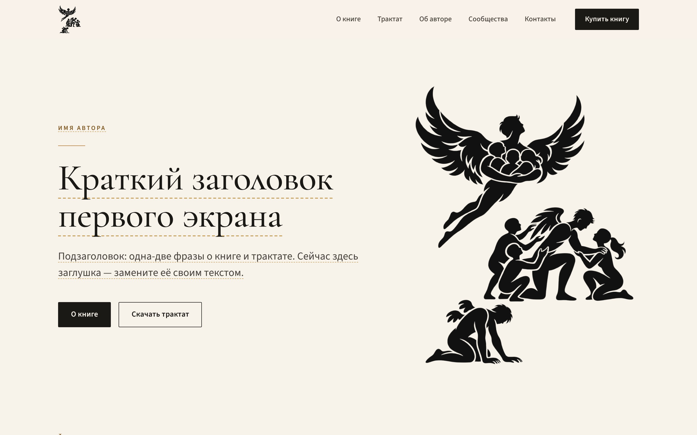

# Сайт автора — макет

Первый визуальный макет одностраничного сайта: книга, трактат, автор, сообщества и контакты.

**Сайт не опубликован.** Оплата и скачивание не подключены, все внешние ссылки — заглушки.



Остальные скриншоты (вся страница на компьютере и на телефоне) — в папке [`docs/preview`](docs/preview).

## Как посмотреть

Откройте `index.html` в браузере (двойной щелчок по файлу). Интернет не нужен: шрифты и логотипы лежат в папке `assets`.

## Как устроены заглушки

Всё, что ещё нужно заполнить, отмечено **золотистым пунктиром**:

- пунктирное подчёркивание — короткие тексты: заголовки, имя, цена, названия ссылок;
- пунктирная линия слева — абзацы: описания и биография;
- пунктирная рамка — места для изображений;
- кнопки и ссылки-заглушки никуда не ведут: при нажатии появляется подсказка «Заглушка: …».

В `index.html` каждое такое место подписано комментарием `ЗАГЛУШКА`, его легко найти поиском.

Кнопка «Купить книгу» в шапке, а также «О книге» и «Скачать трактат» на первом экране — не заглушки: они плавно ведут к нужным блокам страницы.

## Куда класть файлы

Изображения подставляются **автоматически**: положите файл с точным именем в нужную папку — код менять не нужно. Пока файла нет, на его месте видна рамка с подсказкой.

| Что | Имя файла | Рекомендации |
|---|---|---|
| Обложка книги | `assets/book/cover.jpg` | пропорции 2 : 3, от 1200 × 1800 px; показывается целиком, без обрезки |
| Обложка или первая страница трактата | `assets/treatise/cover.jpg` | формат A4 (1 : 1,41), от 1240 × 1754 px; без обрезки |
| Фотография автора | `assets/author/photo.jpg` | вертикальный портрет 4 : 5, от 1200 × 1500 px; кадрируется по рамке 4 : 5 |
| Файл трактата | `assets/treatise/`, например `treatise.pdf` | после загрузки один раз поправить ссылку на кнопке (пример ниже) |

Если у изображения другое расширение (`.png`, `.webp`), переименуйте файл или замените расширение в `index.html` (поиск по имени файла).

### Файл книги

Не кладите файл продаваемой книги в папку сайта: всё, что лежит на сайте, может скачать любой посетитель по прямой ссылке. Книгу лучше выдавать через сервис оплаты после покупки — его подключим отдельно.

## Что заменить текстом и ссылками

| Блок | Что заполнить |
|---|---|
| Вкладка браузера | название вкладки (`<title>`) и описание для поисковиков (`description`) |
| 2. Первый экран | имя автора, краткий заголовок, подзаголовок |
| 3. О книге | название, описание (2–3 абзаца), цена и валюта, ссылка на оплату |
| 4. Трактат | название, описание, формат и размер файла, ссылка на скачивание |
| 5. Об авторе | имя, краткая биография |
| 6. Сообщества и соцсети | подводка (по желанию), карточки: название и ссылка |
| 7. Подвал | имя автора, адрес почты, другой способ связи (по желанию), ссылки на соцсети |

Карточек сообществ и соцсетей сейчас четыре. Лишние можно удалить, недостающие — добавить копированием блока `<li>…</li>`.

### Как заменить ссылку-заглушку

Пример для кнопки «Скачать трактат»:

```html
<!-- было -->
<a class="btn btn--primary btn--lg" href="#treatise" data-placeholder="Заглушка: файл трактата ещё не добавлен.">Скачать трактат</a>

<!-- стало -->
<a class="btn btn--primary btn--lg" href="assets/treatise/treatise.pdf" download>Скачать трактат</a>
```

У настоящей ссылки удалите атрибут `data-placeholder` — именно он включает подсказку «Заглушка». После замены текста удалите класс `ph` или `ph-block`, чтобы убрать пунктир.

## Логотип

- `assets/logo/source/` — исходные файлы в том виде, в каком они были присланы.
- `logo-black.*`, `logo-gold.*` — те же изображения с прозрачным фоном. Убраны только белый фон и пустые поля вокруг; форма, пропорции и цвета не менялись. Белые просветы между фигурами стали прозрачными, поэтому логотип ложится на любой фон.
- Чёрный логотип — в шапке и на первом экране. Золотой — только на тёмном фоне, в подвале.
- На страницу подключены `.webp` (они легче), `.png` — универсальные копии того же логотипа.
- Размер логотипа задаётся только высотой, ширина подстраивается сама, поэтому пропорции не искажаются.

## Оформление

- Цвета, шрифты и размеры — переменные в начале `assets/css/styles.css`. Золотистые оттенки взяты из золотой версии логотипа.
- Шрифты: Cormorant Garamond (заголовки) и Source Sans 3 (текст), оба с полной кириллицей. Хранятся локально, лицензия SIL Open Font License 1.1 (файлы `OFL.txt` рядом со шрифтами).
- Адаптивность проверена на ширине экрана от 320 до 1920 px. На телефоне меню сворачивается в кнопку, «Купить книгу» всегда остаётся в шапке.

## Структура

```
index.html               страница
assets/css/styles.css    оформление
assets/js/main.js        меню, подсказки-заглушки, подстановка изображений
assets/fonts/            шрифты и лицензии
assets/logo/             логотипы
assets/book/             обложка книги
assets/treatise/         обложка и файл трактата
assets/author/           фотография автора
docs/preview/            скриншоты макета
```

## Перед запуском (позже)

- [ ] Заполнить все заглушки (поиск по слову `ЗАГЛУШКА`).
- [ ] Подключить оплату и вставить ссылку в кнопку «Купить книгу» в блоке «О книге».
- [ ] Загрузить файл трактата и вставить ссылку на кнопку «Скачать трактат».
- [ ] Заполнить `<title>` и `description`.
- [ ] Удалить строку `<meta name="robots" content="noindex, nofollow">` — сейчас она закрывает макет от поисковых систем.
- [ ] Решить, какой значок сайта (favicon) использовать: полная иллюстрация в размере 16–32 px почти не читается.
